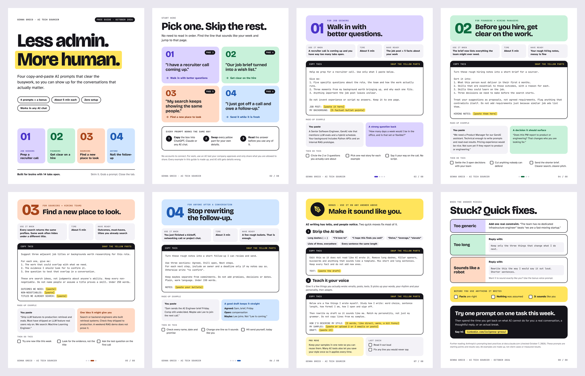

<div align="center">

# Less admin. More human.

**Copy-and-paste AI prompts for job seekers, founders and hiring teams,**<br>
**with evals that prove each prompt keeps its promises.**

[**Use it online**](https://honeycolacodes.github.io/less-admin-more-human/) · [**Download the PDF**](dist/less-admin-more-human.pdf) · [**Browse the prompts**](prompts/)

[](https://github.com/honeycolacodes/less-admin-more-human/actions/workflows/ci.yml)
[](pyproject.toml)
[](pyproject.toml)
[](https://github.com/astral-sh/ruff)
[](LICENSE)
[](CONTENT-LICENSE.md)

</div>



## What this is

Hiring comes with a lot of writing nobody enjoys: prepping for calls, turning a wish list into a real brief, widening a search that keeps hitting the same profiles, and following up after every conversation. These prompts handle the first draft so the time goes to the actual conversations.

Each prompt does one job, tells the AI what **not** to do (invent experience, add requirements, make promises), and leaves clear blanks for your details. They work in ChatGPT, Claude, Gemini or any AI chat.

Behind the prompts is a small, fully tested toolchain: one data file builds a PDF guide, an interactive web tool and Markdown pages, and an eval suite runs every prompt against Claude to check the answers actually follow the rules.

| Format | Best for |
| --- | --- |
| **[Web tool](https://honeycolacodes.github.io/less-admin-more-human/)** | Pick a prompt, type into the blanks, copy the finished prompt. Runs in your browser and sends nothing anywhere. |
| **[PDF guide](dist/less-admin-more-human.pdf)** | An 8-page guide built for skimming. Easy to share as a LinkedIn document post. |
| **[Markdown](prompts/)** | Every prompt as a plain page you can read or fork on GitHub. |

## The prompts

| # | Prompt | For | Use it when |
| --- | --- | --- | --- |
| 01 | [Walk in with better questions](prompts/01-recruiter-call-prep.md) | Job seekers | A recruiter call is coming up |
| 02 | [Before you hire, get clear on the work](prompts/02-hiring-brief.md) | Founders, hiring managers | The brief has turned into a wish list |
| 03 | [Find a new place to look](prompts/03-adjacent-titles.md) | Sourcers, hiring teams | Every search returns the same profiles |
| 04 | [Stop rewriting the follow-up](prompts/04-follow-up.md) | Anyone | You just got off a call |
| B1 | [Strip the AI tells](prompts/b1-strip-ai-tells.md) | Bonus | A draft reads like a template |
| B2 | [Teach it your voice](prompts/b2-match-my-voice.md) | Bonus | You want it to sound like you wrote it |

## Use it online

The web tool turns every blank in a prompt into a text box and shows the finished prompt as you type. Filled parts are highlighted, open blanks stay yellow, and one button copies the result. Each prompt has its own link (for example `#follow-up`) so you can send someone straight to the one they need.

## Prompt evals

A prompt that says "do not invent experience" is only useful if the model obeys it. The eval suite checks that it does.

Each case in [`evals/cases.yaml`](evals/cases.yaml) fills a prompt's blanks with realistic, made-up input, sends it to Claude, and scores the answer two ways:

- **Rule checks** are deterministic: word limits, banned phrases, required sections, and a date detector that fails the answer if it adds any deadline that was not in the notes.
- **Rubric checks** use a grader model to judge one yes-or-no criterion at a time, such as "never claims the candidate has shipped LLM features to production, since their background says they have not."

```yaml
- prompt: follow-up
  name: keeps-maybes-separate
  inputs:
    notes: |
      Sam sends the role brief Friday. Comp still undecided.
      Maybe ask Lee to join the next call.
  checks:
    - max_words: 165
    - contains_all: ["Agreed", "Still open", "Next steps"]
    - no_new_dates: true
    - rubric: Presents Lee joining as a possibility, not as something already agreed.
    - rubric: Keeps compensation as an open question rather than a decision.
```

There are 11 cases and 42 checks covering every prompt, and a test fails if a prompt is added without one. Results print to the console, save as JSON, and appear as a table in the GitHub Actions run summary, with the full model answer attached to every failure.

```bash
lamh eval --dry-run        # see exactly what would be sent and checked, no API key needed
lamh eval                  # run for real (needs ANTHROPIC_API_KEY)
lamh eval --only follow-up --model claude-haiku-5-5
```

To run them in GitHub Actions, add your key as a repository secret named `ANTHROPIC_API_KEY`, then open **Actions > Prompt evals > Run workflow**. They also run on their own whenever a prompt or eval case changes.

## How it works

One data file feeds everything, so the PDF, the web tool, the Markdown pages and the evals can never disagree.

```
data/prompts.json
 ├── lamh prompts   ->  prompts/*.md
 ├── lamh pdf       ->  dist/less-admin-more-human.pdf  (+ assets/preview.png)
 ├── lamh site      ->  _site/  (deployed to GitHub Pages)
 └── lamh eval      ->  runs every prompt against Claude, grades the answers

lamh check          ->  fails CI on structural errors or AI-sounding copy
```

- **The PDF is HTML and CSS.** Pages are Jinja templates rendered to PDF by headless Chromium through Playwright. The build measures every page and refuses to export one whose content runs past the edge of its sheet.
- **Python and JavaScript render prompts identically, and a test proves it.** The web tool fills prompts in the browser with [`site/render.js`](site/render.js); the PDF and evals use [`lamh.content`](src/lamh/content.py). A parity test feeds both the same prompts and tricky inputs (whitespace, unicode, literal braces, `$&` replacement patterns) and compares the output character by character.
- **The content checker practices what the guide preaches.** It validates every prompt's structure and fails the build if the copy contains long dashes or stock AI phrases.
- **The web tool is plain HTML, CSS and JavaScript.** No framework, no build step, no tracking, keyboard accessible, and it works on a phone.

## Code quality

- **Over 100 tests** with pytest, and CI fails if coverage drops below 90%. The eval runner is tested end to end with a fake model client, so no test touches the network.
- **mypy in strict mode** across the whole package, with typed models for the data file.
- **Ruff** for linting and formatting, and **pre-commit** hooks that run lint, types and the content check before every commit.
- **CI on Python 3.11, 3.12 and 3.13**, plus jobs that build the PDF, deploy the site, run the evals and publish releases.

## Build it yourself

You need Python 3.11 or newer, and Node.js if you want to run the parity test.

```bash
git clone https://github.com/honeycolacodes/less-admin-more-human.git
cd less-admin-more-human
python -m venv .venv && source .venv/bin/activate   # Windows: .venv\Scripts\activate
make install    # installs the package, Chromium and the pre-commit hooks

make quality    # lint, type check, tests
make all        # check content, then build the Markdown, the PDF and the site
make serve      # preview the web tool at http://localhost:8000
```

No `make`? Use `pip install -e ".[dev]"`, `python -m playwright install chromium`, then the `lamh` commands directly. Run `lamh --help` for the full list.

## Project structure

```
.
├── data/prompts.json          # every prompt, example, color and line of copy
├── evals/cases.yaml           # eval cases: inputs plus the checks each answer must pass
├── src/lamh/                  # the Python package and `lamh` command
│   ├── content.py             #   typed data model and prompt rendering
│   ├── checker.py             #   structure checks and the AI-tell linter
│   ├── markdown.py            #   builds prompts/*.md
│   ├── guide.py               #   builds the PDF and preview image
│   ├── site.py                #   assembles the web tool
│   ├── cli.py                 #   the `lamh` command
│   └── evals/                 #   cases, rule checks, grader, runner, model client
├── tests/                     # pytest suite, including the Python/JS parity test
├── site/                      # the web tool (render.js is shared with the parity test)
├── guide/                     # Jinja templates, print CSS and open source fonts
├── prompts/                   # generated Markdown, one page per prompt
├── dist/                      # the built PDF
└── .github/workflows/         # CI, evals, Pages deploy and releases
```

## Set up GitHub Pages (one time)

1. Push this repo to GitHub.
2. Go to **Settings > Pages** and set **Source** to **GitHub Actions**.
3. Push to `main`. The site deploys to `https://honeycolacodes.github.io/less-admin-more-human/`.

To publish a release with the PDF attached, push a tag such as `v1.1.0`.

## Make it yours

- **Add your LinkedIn.** Set `author.linkedin` in `data/prompts.json` and run `make all`. It appears on the last page of the PDF and on the site.
- **Add or edit a prompt.** Everything lives in `data/prompts.json`, and every prompt needs an eval case. See [CONTRIBUTING.md](CONTRIBUTING.md).

## License

- **Code** (package, tests, templates, site): [MIT](LICENSE)
- **Prompts and guide content:** [CC BY 4.0](CONTENT-LICENSE.md). Share and adapt them, including commercially, with credit to Genna Greco.
- **Fonts:** [SIL Open Font License](guide/fonts/), from their original authors.

## About

Made by **Genna Greco**, senior technical sourcer. I help venture-backed AI startups hire through Recruit to Suit.
[Connect on LinkedIn](https://www.linkedin.com/in/genna-greco/)

Prompting approach informed by [Anthropic's prompt engineering guide](https://docs.claude.com/en/docs/build-with-claude/prompt-engineering/overview). All examples are made up. AI still gets things wrong, so read before you send.
